<picture>
  <source media="(prefers-color-scheme: dark)" srcset="./dark.svg">
  <source media="(prefers-color-scheme: light)" srcset="./light.svg">
  
</picture>

  

### AI & ML Student | Developer | Software Engineering Enthusiast

*Building Software. Exploring AI. Creating Useful Experiences.*

---

## About Me

Hi, I'm **Jaswant Yadav** — an Artificial Intelligence and Machine Learning student and developer passionate about software engineering, AI-powered applications, and building practical digital experiences.

I enjoy exploring new technologies, developing projects, solving problems, and continuously improving my engineering skills.

- **Academic Background:** B.Tech Artificial Intelligence and Machine Learning student
- **Direction:** Software Development, AI/ML, and Full-Stack Development
- **Primary Interests:** Artificial Intelligence, Machine Learning, Deep Learning, Python, Software Engineering, Web Development, Automation, and System Design

---

## Current Learning and Focus

- Strengthening Python and programming fundamentals.
- Learning AI, Machine Learning, and Deep Learning.
- Improving software engineering and full-stack development skills.
- Building practical projects.
- Learning system design and modern development workflows.

---

## Featured Projects

> Ordered intentionally to reflect my core technical explorations across quantum simulation, AI SaaS, product transparency, and interactive web applications.

<table>
  <tr>
    <td width="50%" valign="top">
      <h3>01. <a href="https://github.com/jaswant-0707/QuantumX">QuantumX</a></h3>
      
Quantum algorithm learning and simulation platform featuring a browser-native TypeScript complex-amplitude engine, quantum gate simulation, 3D Bloch sphere visualization, and mathematical unit testing alongside a Python backend integration.

      

        <strong>Highlights:</strong> 
        • Quantum gate simulation &amp; complex amplitude engine 
        • 3D Bloch sphere visualization &amp; mathematical testing
      

      
<code>TypeScript</code> · <code>React</code> · <code>Python</code> · <code>Quantum Simulation</code>

    </td>
    <td width="50%" valign="top">
      <h3>02. <a href="https://github.com/jaswant-0707/mika-whatsapp-saas">mika-whatsapp-saas</a></h3>
      
Multi-user WhatsApp AI assistant platform built with Node.js, Express, Socket.io, Baileys, Firebase Authentication, and Firebase Realtime Database, featuring per-chat temporary and persistent memory, AI model failover (Groq), web search integration, wait commands, and ignore lists.

      

        <strong>Highlights:</strong> 
        • Isolated multi-user sessions &amp; Firebase Auth/RTDB 
        • Per-chat memory, AI failover &amp; real-time dashboard
      

      
<code>JavaScript</code> · <code>Node.js</code> · <code>Firebase</code> · <code>API Integration</code>

    </td>
  </tr>
  <tr>
    <td width="50%" valign="top">
      <h3>03. <a href="https://github.com/jaswant-0707/PureScan-APP">PureScan-APP</a></h3>
      
Product transparency web application ("Listen to Science, Not Marketing") that analyzes food ingredients, fetches product imagery, and provides an AI health chat and wellness modules powered by Netlify serverless functions and Firebase.

      

        <strong>Highlights:</strong> 
        • AI ingredient analysis &amp; health chat assistant 
        • Firestore/Storage rules, Capacitor &amp; multi-language support
      

      
<code>JavaScript</code> · <code>HTML/CSS</code> · <code>Firebase</code> · <code>Netlify</code> · <code>Capacitor</code>

    </td>
    <td width="50%" valign="top">
      <h3>04. <a href="https://github.com/jaswant-0707/diwali-surprise">diwali-surprise</a></h3>
      
Interactive Diwali greeting and surprise link generator featuring personalized messages, multi-channel sharing (WhatsApp, Instagram, Facebook, Telegram, X, SMS, Email, Web Share), a 3D gift box reveal, dual-canvas fireworks, Web Audio sound effects with synthesizer fallback, and a 5-star feedback system.

      

        <strong>Highlights:</strong> 
        • Personalized greeting generator &amp; multi-channel sharing 
        • Dual-canvas fireworks &amp; Web Audio synthesis
      

      
<code>JavaScript</code> · <code>HTML</code> · <code>CSS</code> · <code>Web Audio API</code>

    </td>
  </tr>
  <tr>
    <td width="50%" valign="top">
      <h3>05. <a href="https://github.com/jaswant-0707/Profile-jaswant0707">Profile-jaswant0707</a></h3>
      
Multi-layout personal developer portfolio website that dynamically routes visitors across four distinct profile designs (<code>Profile1</code>–<code>Profile4</code>) showcasing bio, skills, and project galleries.

      

        <strong>Highlights:</strong> 
        • Multi-theme profile showcase architecture 
        • Responsive layouts &amp; project presentation pages
      

      
<code>HTML</code> · <code>CSS</code> · <code>JavaScript</code> · <code>Responsive Web</code>

    </td>
    <td width="50%" valign="top">
      <h3>06. <a href="https://github.com/jaswant-0707/Happy-birthday-ever-one">Happy-birthday-ever-one</a></h3>
      
Interactive birthday celebration webpage generator allowing senders to input recipient details, date of birth, friendship start date, and a photo preview to generate a shareable link leading to an animated celebration page with music and typewriter effects.

      

        <strong>Highlights:</strong> 
        • Personalized birthday link builder &amp; social sharing 
        • Animated celebration view with audio playback
      

      
<code>HTML</code> · <code>CSS</code> · <code>JavaScript</code>

    </td>
  </tr>
</table>

---

## Tech Stack

### Used in Projects

| Category | Technologies |
| :--- | :--- |
| **Languages** | Python, JavaScript, TypeScript, HTML, CSS |
| **Frontend & Web** | HTML, CSS, JavaScript, TypeScript, React, Responsive Web Development |
| **Backend, Cloud & Tools** | Firebase, Firestore, Firebase Realtime Database, Node.js, Git, GitHub, Netlify, Capacitor |
| **Applied Domains** | Automation, API Integration, Quantum Computing Simulations, AI-powered applications |

### Currently Learning & Exploring

| Area | Focus |
| :--- | :--- |
| **AI / ML / Data** | Artificial Intelligence, Machine Learning, Deep Learning, NumPy, Pandas |
| **Engineering Foundations** | System Design, Scalable Backend Workflows, Software Architecture |

---

## GitHub Statistics

Activity, commits, and repository updates are maintained directly on my primary GitHub profile:

- **Primary Profile:** [github.com/jaswant-0707](https://github.com/jaswant-0707)
- **Focus Areas:** AI/ML learning repositories, full-stack web apps, and simulation/automation experiments.

*(External third-party stats card services that were unavailable or returning incomplete contribution totals have been intentionally omitted for accuracy.)*

---

## Connect With Me

- **GitHub:** [https://github.com/jaswant-0707](https://github.com/jaswant-0707)
- **LinkedIn:** [https://www.linkedin.com/in/jaswant-yadav0707](https://www.linkedin.com/in/jaswant-yadav0707)
- **Instagram:** [https://www.instagram.com/jaswant_0707/](https://www.instagram.com/jaswant_0707/)
- **Facebook:** [https://www.facebook.com/jaswant0707/](https://www.facebook.com/jaswant0707/)
